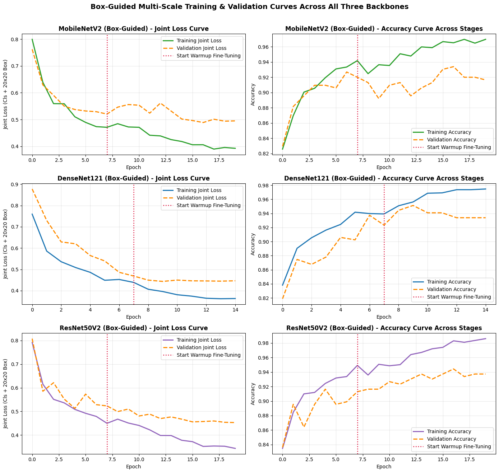
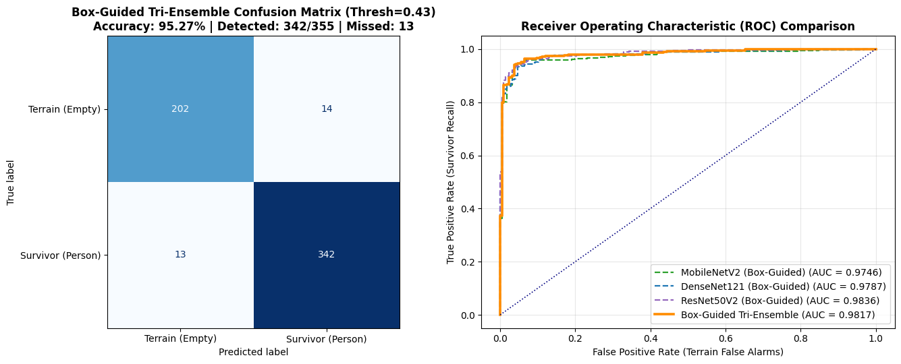
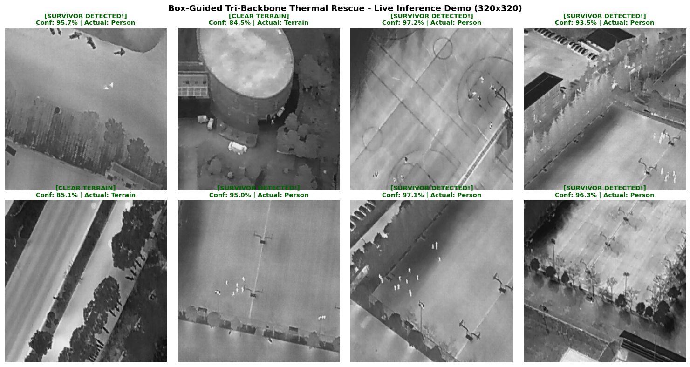

# 🚨 UAV Thermal Search & Rescue: Box-Guided Tri-Backbone Ensemble
**نظام البحث والإنقاذ الليلي عبر طائرات الدرون بالتصوير الحراري والتعلم العميق الموجه مكانياً**

[](https://www.tensorflow.org/)
[](https://keras.io/)
[]()
[]()
[]()

**إعداد وتطوير المهندس:** **أحمد المصقري (Ahmed Al-Masqari)**

---

## 📌 نظرة عامة على المشروع (Project Overview)
يمثل الرصد الليلي للناجين والمفقودين من ارتفاعات شاهقة (60m - 130m) عبر كاميرات الأشعة تحت الحمراء (Infrared Thermal Imaging) تحدياً كبيراً في الرؤية الحاسوبية؛ نظراً لصغر حجم الهدف البشري والتشويش الحراري الناتج عن التضاريس والصخور المشعة للحرارة ليلاً.

يقدم هذا المشروع معمارية تعلم عميق متقدمة (**Box-Guided Spatial Attention Tri-Backbone Ensemble**) مطبقة على مجموعة بيانات **HIT-UAV**، تجمع بين **التصنيف الشامل للمشهد** و**التوجيه المكاني الدقيق بصناديق الإحاطة (`20×20` Bounding-Box Guided Heatmaps)** لعزل البصمة الحرارية للإنسان وتصفير ضجيج الخلفية.

---

## 🧠 الابتكارات الهندسية والمعمارية (Architectural Innovations)

1. **بوابة الانتباه المكاني الموجهة بصناديق الإحاطة (`20×20` Spatial Attention Gate):**
   * استخراج إحداثيات الأجسام البشرية من ملفات YOLO وتحويلها إلى خرائط انتباه مكانية بحجم **`20×20`** مدعومة بهالة حرارية غاوسية ناعمة لالتقاط الناجين متناهي الصغر عند دقة إدخال **`320×320`**.
2. **الدمج الهرمي متعدد المقاييس (Multi-Scale Feature Fusion):**
   * دمج السمات المكانية الدقيقة (`20×20`) مع السمات السياقية العميقة (`10×10`) عبر طبقات `UpSampling2D` و`Conv2D` وتنشيط `Swish`.
3. **دوال خسارة مزدوجة ومخصصة (Dual Custom Loss Functions):**
   * دمج دالة **`weighted_life_bce_loss`** (لإعطاء أولوية قصوى لحياة الناجين) مع دالة **`spatial_box_heatmap_loss`** (لتعليم الشبكة موقع الهدف البشري).
4. **الاتحاد الثلاثي الموزون والتقييم الرباعي (Tri-Backbone Ensemble + 4-View TTA):**
   * دمج 3 معماريات عميقة مدربة بجدولة `Warmup-Cosine` ومُحسِّن `AdamW` بالأوزان المثلى المعايرة على التحقق: **`MobileNetV2` (0.50)** + **`DenseNet121` (0.35)** + **`ResNet50V2` (0.15)** مع فحص كل صورة بـ 4 وضعيات مكانية (`4-View TTA`).

---

## 📊 جدول المقارنة الشامل لأداء المعماريات على مجموعة الاختبار (Test Set = 571)

يوضح الجدول التالي تفوق كل معمارية فردية، وكيف نجح **الاتحاد الثلاثي (Tri-Ensemble)** عند العتبة المثالية (`Threshold = 0.43` | `Val ROC-AUC = 98.88%`) في تحقيق أعلى دقة وأعلى حساسية إنقاذ:

| المعمارية (Model Architecture) | الدقة الكلية (Accuracy) | المساحة تحت المنحنى (ROC-AUC) | حساسية كشف الناجين (Survivor Recall) | دقة التمييز (Precision) | مقياس التوازن (F1-Score) |
| :--- | :---: | :---: | :---: | :---: | :---: |
| **1. MobileNetV2 (Box-Guided)** | 93.70% | 97.46% | 92.11% (327/355) | **97.61%** | 94.78% |
| **2. DenseNet121 (Box-Guided)** | 93.35% | 97.87% | 96.06% (341/355) | 93.42% | 94.72% |
| **3. ResNet50V2 (Box-Guided)** | 94.22% | **98.36%** | 95.77% (340/355) | 94.97% | 95.37% |
| **4. Box-Guided Tri-Ensemble (النموذج النهائي)** | **95.27%** | 98.17% | **96.34% (342/355)** | 96.07% | **96.20%** |

### التقرير الإحصائي التفصيلي للاتحاد الثلاثي (Optimized Test Report):
```text
                   precision    recall  f1-score   support

  Terrain (Empty)     0.9395    0.9352    0.9374       216
Survivor (Person)     0.9607    0.9634    0.9620       355

         accuracy                         0.9527       571
        macro avg     0.9501    0.9493    0.9497       571
     weighted avg     0.9527    0.9527    0.9527       571
```

* 🎯 **الناجون المكتشفون بنجاح:** **342 ناجياً من أصل 355** (المفقودون: **13 حالة فقط**).
* 🎯 **التضاريس الفارغة المعزولة بنجاح:** **202 مشهد من أصل 216** (الإنذارات الكاذبة: **14 حالة فقط**).

---

## 📈 المخططات والنتائج البصرية (Visual Diagnostics)

### 1. منحنيات التعلم الموجهة بصناديق الإحاطة (Box-Guided Learning Curves)
توضح استقرار التدريب وهبوط الخسارة المشتركة (التصنيف + التحديد المكاني `20×20`) عبر مرحلتي استخلاص الخصائص والضبط الدقيق (`Warmup Fine-Tuning`):


### 2. مصفوفة الالتباس ومقارنة منحنيات الكفاءة (Confusion Matrix & ROC Comparison)
تُظهر مصفوفة الالتباس اكتشاف 342 ناجياً وتصنيف 202 مشهد تضاريس خالية بدقة، مع مقارنة منحنيات `ROC` للمعماريات الثلاث والاتحاد الثلاثي:


### 3. محاكاة الفحص الميداني اللحظي للدرون (Live 4-View TTA Inference Demo)
استعراض حي لتنبؤات الاتحاد الثلاثي على عينات عشوائية من مجموعة الاختبار بدرجات ثقة عالية جداً:


---

## 🗂️ هيكل المستودع (Repository Structure)
* `HIT_UAV_BoxGuided_TriEnsemble.ipynb`: دفتر الكود الكامل شاملاً معالجة البيانات، بناء خرائط الانتباه `20×20`، تدريب الاتحاد الثلاثي، والتقييم الرباعي `4-View TTA`.
* `box_guided_learning_curves.png`: منحنيات الدقة والخسارة لمرحلتي التدريب.
* `box_guided_evaluation_metrics.png`: مصفوفة الالتباس ومقارنة منحنيات `ROC-AUC` على مجموعة الاختبار.
* `box_guided_inference_demo.png`: لوحة نتائج الفحص البصري لعينات الاختبار.
* `README.md`: التوثيق الشامل للمشروع والمنهجية والنتائج.

---

## 🛠️ التقنيات والأدوات المستخدمة (Tech Stack)
* **Deep Learning Framework:** TensorFlow 2.x / Keras (`Functional API`, Custom Losses, `tf.data` Pipeline)
* **Backbone Architectures:** `MobileNetV2`, `DenseNet121`, `ResNet50V2`
* **Optimization & Regularization:** `AdamW` Optimizer, `Warmup-Cosine` Scheduler, `L2` Regularization, `BatchNormalization`, `Swish` Activation
* **Evaluation & Visualization:** Scikit-Learn, NumPy, Matplotlib
* **Hardware Accelerator:** Google Colab NVIDIA Tesla T4 GPU
* **Dataset:** [HIT-UAV High-altitude Infrared Thermal Dataset](https://www.kaggle.com/datasets/pandrii000/hituav-a-highaltitude-infrared-thermal-dataset)

---

## 👨‍💻 المؤلف (Author)
* **المهندس أحمد المصقري (Eng. Ahmed Al-Masqari)**
